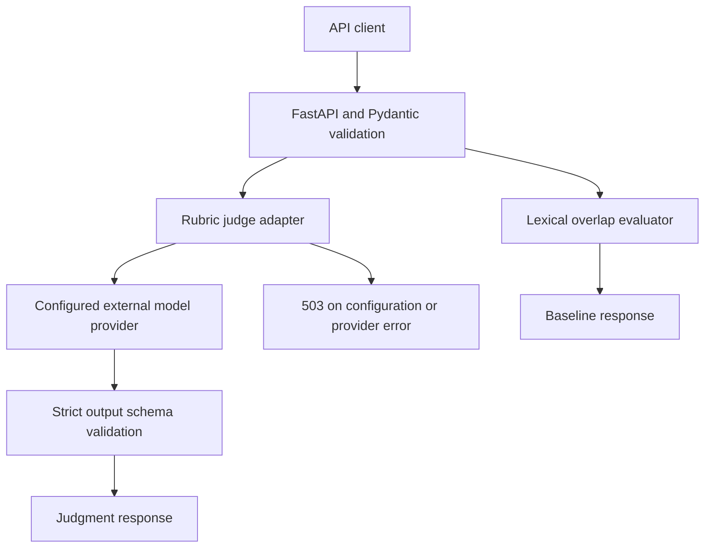
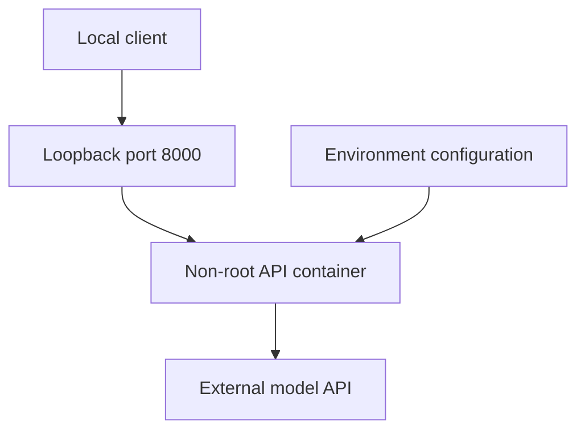
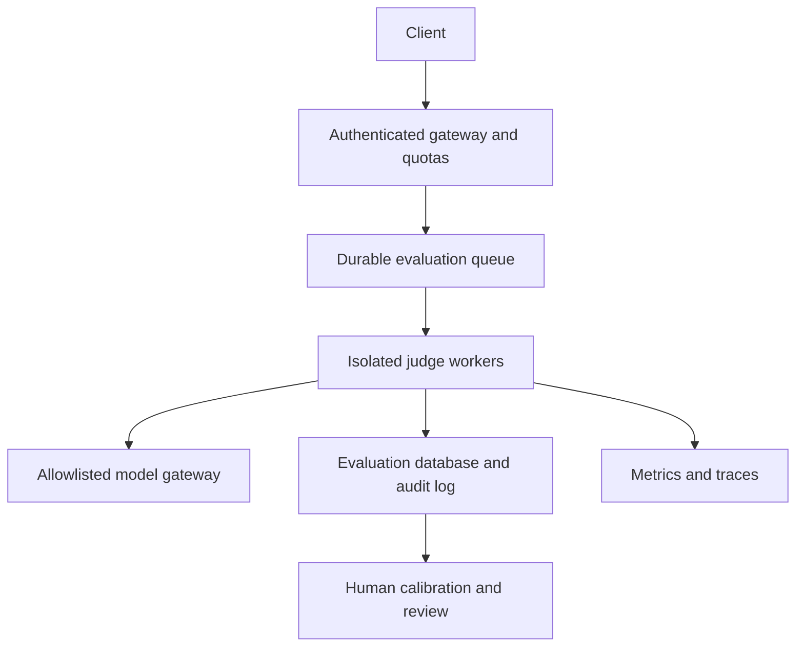

# Architecture

## Implemented request flow

`app/main.py` exposes health, rubric discovery and two evaluation endpoints.
`app/judge.py` makes one synchronous HTTP request with a 30-second HTTPX timeout.
The judge uses temperature zero and requests JSON output. Returned scores must be
between zero and one; verdicts are pass/fail/review. This checks structure, not
correctness. Evidence strings are not independently checked against the context.
The baseline measures ASCII token overlap and never returns pass.

## Deployment and trust boundaries

Compose binds only to localhost. No database, queue, dashboard, authentication or
persistent audit log exists. The health endpoint reports process liveness, not
model availability. User question, context and answer leave the deployment when
`/v1/judge` calls the configured provider. The server operator controls provider
URL and credentials; callers cannot override them through the API.

Request fields have a 50,000-character limit each. This is not a transport-level
body limit. Prompts label submitted content as untrusted, but that does not prove
resistance to prompt injection. A valid schema is not evidence of judge accuracy.

## Proposed production architecture (not implemented)

See [production readiness](PRODUCTION_READINESS.md) for the remaining work.
